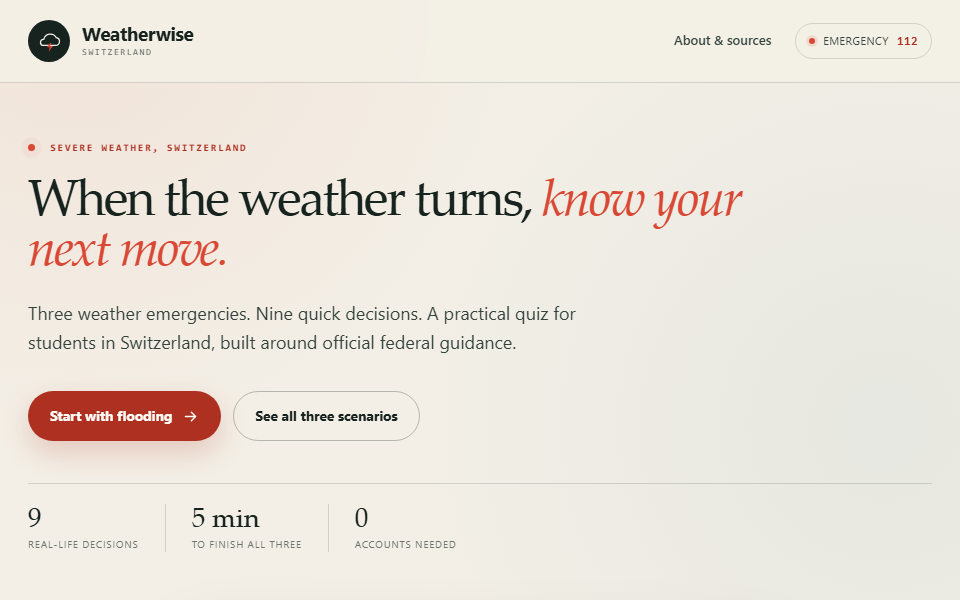

# Weatherwise

**A short, honest quiz about extreme weather safety in Switzerland, built for students.**

[Live demo](https://weather-quiz-022114083833448235831.vercel.app) | HTML, CSS and JavaScript, no build step



Three scenarios, three multiple-choice questions each, immediate feedback with the reason, and links
to official Swiss federal guidance. No account, no database, no live weather data.

## What it does

- **Three scenarios**: flooding, heatwaves and severe thunderstorms.
- **Three questions per scenario**, four options each.
- **Feedback that teaches**: a clear verdict, a short explanation, and one or two links to official
  guidance so a student can check the source.
- **A live score while answering**, then a final score out of three with a review of every decision
  and the key takeaways.
- **A way forward**: retry the scenario, pick another, or jump straight into the next one.
- **Last score per scenario** kept for the browser session.
- **Built for a classroom**: responsive down to phones, keyboard-accessible answers, visible focus
  states, a skip link and reduced-motion support.

## Run it locally

```bash
node dev-server.mjs
```

Open <http://127.0.0.1:4173>. Nothing to install. If the port is taken, use
`$env:PORT=4174; node dev-server.mjs` on Windows or `PORT=4174 node dev-server.mjs` elsewhere.

The content is loaded with `fetch`, so open the app through the local server rather than
double-clicking `index.html`. Any static server works too, for example
`python -m http.server 4173`.

## Verify

```bash
node scripts/verify.mjs
```

Checks the content model, the answer keys, the required files, accessibility hooks and the static
routes over HTTP.

## How it is built

| Path | Purpose |
|---|---|
| `index.html` | The quiz shell |
| `app.mjs` | Rendering, scoring, feedback and flow |
| `quiz-core.mjs` | Pure scoring and progression rules |
| `content/` | Scenario questions, explanations and source links |
| `styles.css` | The visual system |
| `AI_DISCLOSURE.md` | How the draft content was produced |
| `DEPENDENCIES.md` | The (empty) dependency list, on purpose |

## What is simulated

There is no live weather data: the questions and explanations are a fixed educational set. Draft
content is based on official Swiss guidance, and `AI_DISCLOSURE.md` records how it was produced.

## About this prototype

Built as a working prototype for a real brief, then published as part of a portfolio. The point is
the restraint: a small quiz with sourced answers and real accessibility, instead of a learning
platform nobody asked for.
